# 🌸 SakurApp - 2026
> **Trabajo Final Integrador (TFI)**  
> **Universidad Tecnológica Nacional - Facultad Regional Avellaneda (UTN FRA)**  
> **Grupo:** Sakura  
> **Repositorio:** `sakurapp-2026`

---

## Integrantes y Backlog

La planificación, fechas de inicio/finalización, branches y detalle de historias de usuario se gestionan centralizadamente en el **Backlog oficial de GitHub Projects**:

* 📌 **Tablero de Proyecto & Backlog:** [GitHub Projects - Tablero Sakura](https://github.com/users/ferlautaro2001/projects/2)
* 🎫 **Gestión de Incidencias & User Stories:** [Issues del Repositorio](https://github.com/ferlautaro2001/sakurapp-2026/issues)

### Integrantes, módulos y plazos

Cada fila deja asentado quién develops cada módulo, desde cuándo y hasta cuándo, y en qué
branch vive su trabajo. Si un integrante no llegara a terminar con la funcionalidad
comprometida, el plazo se cambia o el módulo se reasigna, y queda registrado acá.

| Integrante | Rol | Módulos (objetivos) a desarrollar | Fecha de inicio | Fecha de finalización | Branch |
| :--- | :--- | :--- | :--- | :--- | :--- |
| **Fernandez Di Bella, Lautaro Alfredo** (@ferlautaro2001) | Líder de proyecto | Épica 0 (Infraestructura, Data Connect, Design System) · US-1.4 (home y logout) · US-3.2 (push + correo corporativo) · US-4.3 (mesas y QR) · US-5.3 (asignación de mesa) · US-6.2 (consulta al mozo y chat) · integración de `main` y anotación en las revisiones semanales | 22-08-2026 | 17-10-2026 *(en curso: Épicas 8 a 15)* | `lauti` · `feat/setup-design-splash` · `feat/backend-data-auth` |
| **Graneros, Johann** (@johanngraneros) | Desarrollo | US-4.1 (alta de platos con 3 fotos) · US-4.4 (tablero de mesas) · US-6.1 (carta desde el QR de mesa) · US-7.1 (comanda digital con total acumulado) | 28-08-2026 | 12-09-2026 | `johann` |
| **Garcez, Gonzalo** (@gonzadjstaff-hue) | Desarrollo | US-3.3 (alta de personal con foto y lector de DNI) · US-4.2 (alta de bebidas y coctelería) · US-5.2 (lista de espera del metre) · US-7.3 (confirmación del pedido y derivación a sectores) | 29-08-2026 | 09-09-2026 | `gonzalo` · `feat/login-accesos-rapidos` |
| **Nagel Cano, Sabrina** (@sabrinanagel) | Desarrollo | US-3.1 (aprobación y rechazo de clientes) · US-5.1 (invitado y QR de ingreso) · US-7.2 (rechazo de la comanda y re-edición) | 29-08-2026 | 19-10-2026 | `sabrina` · `feat/registro-cliente-home` |

> **Estado de los plazos al 20-10-2026:** no hay módulos sin terminar ni plazos vencidos.
> Los módulos entregados hasta el punto 15 del enunciado están terminados y verificados.
> El trabajo que sigue (puntos 16 a 24) está asignado y anotado en las issues nuevas del
> backlog, con su responsable y su branch.

---

## Tech Stack

<p align="left">
  
  
  
  
  
  
  
  
</p>

* **Framework & UI:** Angular 22 (Standalone Components) & Ionic 9 (`@ionic/angular`)
* **Mobile Runtime & Hardware:** Capacitor 8 (Cámara, Lector de Códigos de Barra/QR, Hápticos, Notificaciones)
* **Backend & Autenticación:** Firebase Authentication & Cloud Firestore / Data Connect / SQL Connect
* **Lenguajes & Estilos:** TypeScript 6, HTML5, SCSS/CSS3, Tailwind CSS & Font Awesome

---

## Índice Visual de Pantallas

Todas las imágenes del proyecto están en la carpeta [`visuals/`](visuals/) y se indexan acá.

### Capturas de las pantallas

| # | Pantalla | Imagen |
| :--- | :--- | :---: |
| 01 | Splash animado | 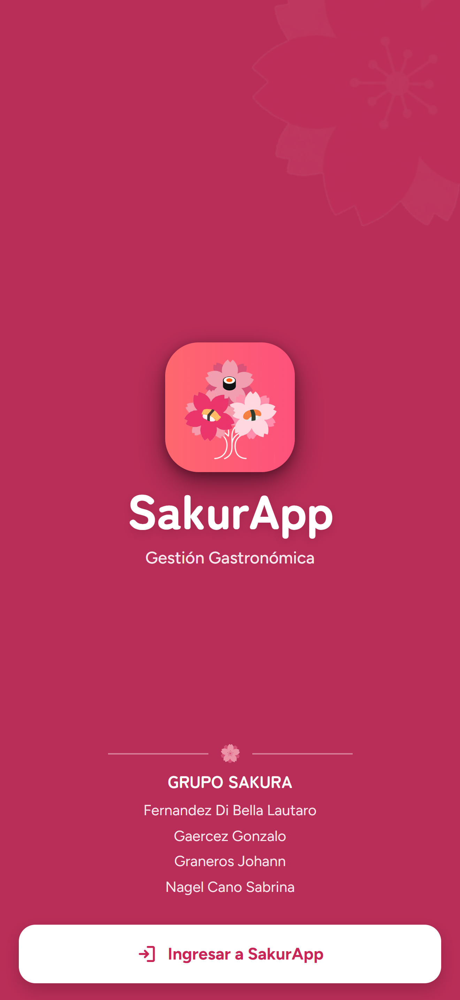 |
| 02 | Presentación estática |  |
| 03 | Login con accesos rápidos | 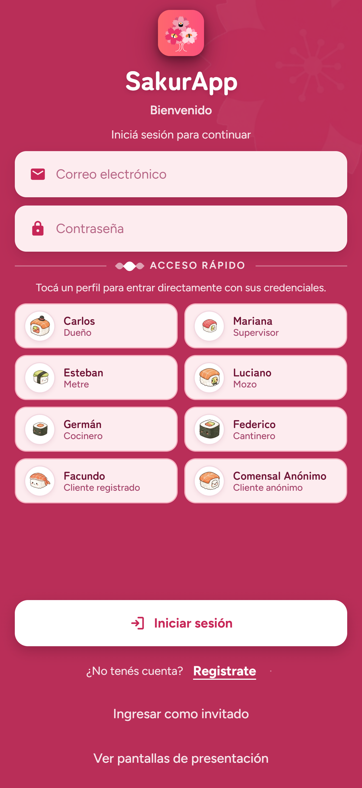 |
| 04 | Registro de cliente | 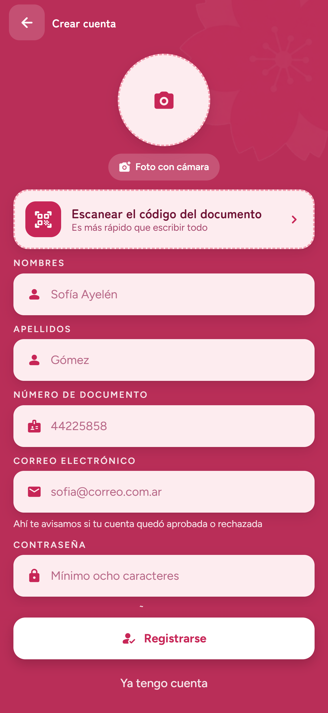 |
| 05 | Registro enviado | 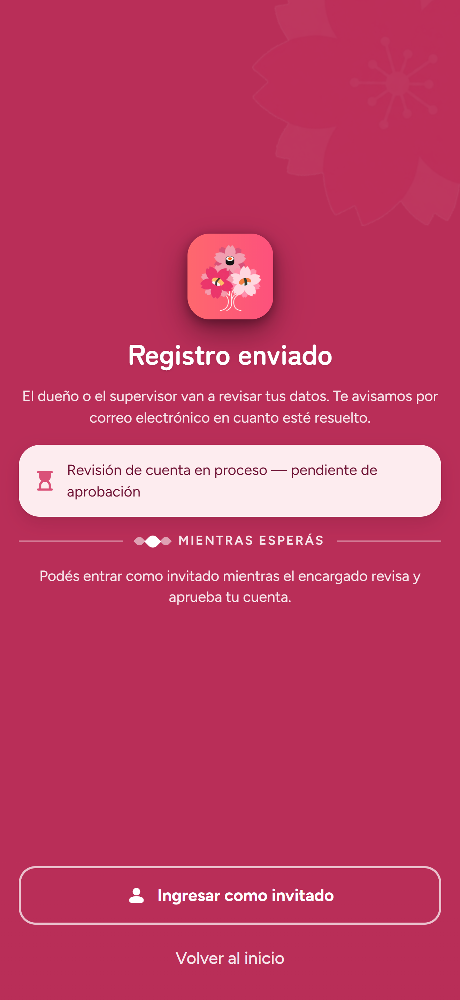 |
| 06 | Registro de invitado | 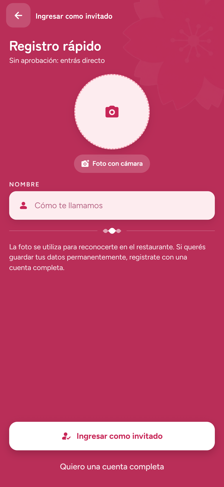 |
| 07 | Cuenta pendiente de aprobación | 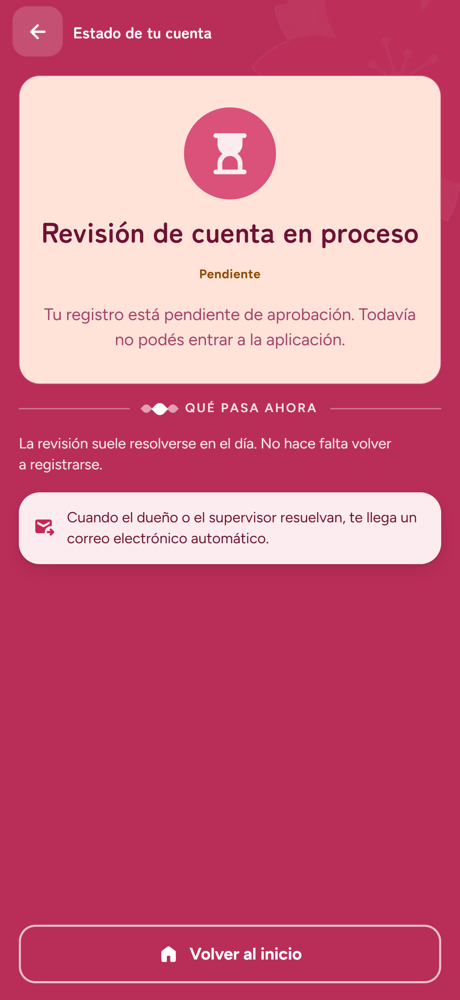 |
| 08 | Cuenta rechazada | 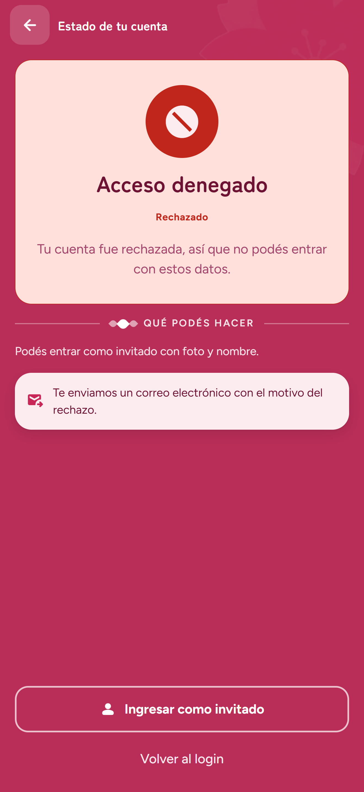 |
| 09 | Home de la sesión | 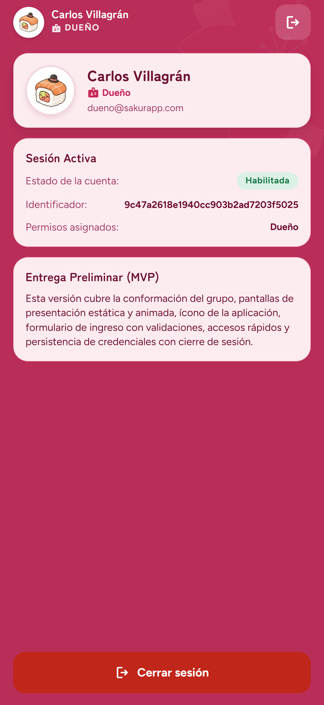 |
| 10 | Confirmación de cierre de sesión | 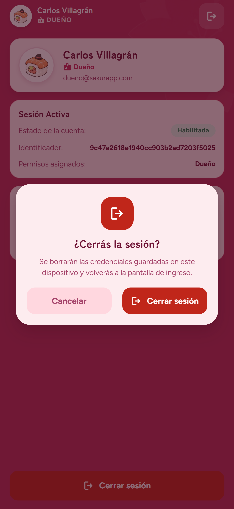 |
| 11 | Login con error de validación | 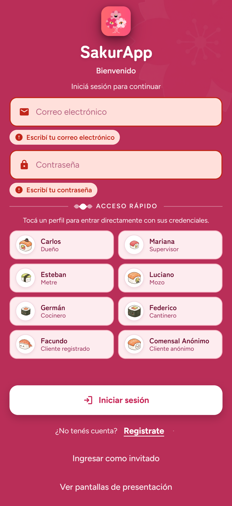 |

### Paleta de marca

| Imagen | Imagen |
| :---: | :---: |
| 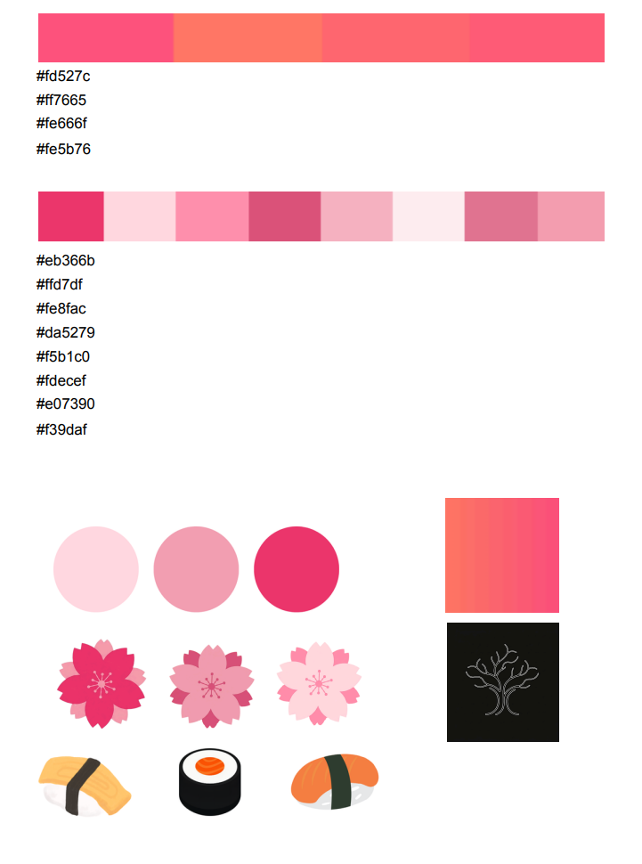 | Paleta de colores y tipografías de Sakura |

### Códigos QR

Los 18 códigos QR del sistema (ingreso al local, 12 mesas y 5 propinas) están indexados con su
contenido en el [catálogo de códigos QR](#catálogo-de-códigos-qr-del-sistema) de más abajo.

### Galería externa

El sitio con todas las capturas en alta resolución, de los flujos y componentes de la
aplicación, está en:

🔗 **https://sakupantallas.vercel.app/**

---

## Catálogo de Códigos QR del Sistema

Códigos QR funcionales requeridos por la cátedra para pruebas y corrección desde la aplicación:

| Tipo de QR | Propósito / Contenido | Código QR |
| :--- | :--- | :---: |
| **Ingreso al Local** | Registro en lista de espera y encuestas.<br>`SAKURAPP:INGRESO` |  |
| **Mesa 1 (Estándar)** | Capacidad: 2 personas.<br>`SAKURAPP:MESA:1:5789beaababa4871915f0a6daaab091f` |  |
| **Mesa 2 (Estándar)** | Capacidad: 4 personas.<br>`SAKURAPP:MESA:2:3c5e4358468348998b390045fcbd31d7` |  |
| **Mesa 3 (Mov. Reducida)** | Capacidad: 4 personas.<br>`SAKURAPP:MESA:3:b65214c7b54f4fd189e46a60d0bee9d5` |  |
| **Mesa 4 (VIP)** | Capacidad: 6 personas.<br>`SAKURAPP:MESA:4:94a7066ea3494bdcbedd1c2459845a15` |  |
| **Mesa 5 (VIP)** | Capacidad: 8 personas.<br>`SAKURAPP:MESA:5:2f7aaec4773e44eea0a4a520aff439d9` |  |
| **Mesa 6 (Estándar)** | Capacidad: 2 personas.<br>`SAKURAPP:MESA:6:26ebe315479c4e7ca161ad71cf6ebfb3` |  |
| **Mesa 7 (Estándar)** | Capacidad: 2 personas.<br>`SAKURAPP:MESA:7:7a9ea8a4452543fab7bb4f99c6229588` |  |
| **Mesa 8 (Estándar)** | Capacidad: 10 personas.<br>`SAKURAPP:MESA:8:7920ad78064f40c188a1ebc2942edc37` |  |
| **Mesa 9 (Estándar)** | Capacidad: 2 personas.<br>`SAKURAPP:MESA:9:548920e39c014878947a83ef04518674` |  |
| **Mesa 10 (Estándar)** | Capacidad: 4 personas.<br>`SAKURAPP:MESA:10:9374985bbe1b417cbe23641cbee50021` |  |
| **Mesa 11 (VIP)** | Capacidad: 10 personas.<br>`SAKURAPP:MESA:11:c7929488007148a691185152881a3311` |  |
| **Mesa 12 (VIP)** | Capacidad: 5 personas.<br>`SAKURAPP:MESA:12:de59b91d24cb4fdb86971a320f1d2223` |  |
| **Propina Excelente (20%)** | Registrar 20% de propina.<br>`SAKURAPP:PROPINA:20` |  |
| **Propina Muy Bueno (15%)** | Registrar 15% de propina.<br>`SAKURAPP:PROPINA:15` |  |
| **Propina Bueno (10%)** | Registrar 10% de propina.<br>`SAKURAPP:PROPINA:10` |  |
| **Propina Regular (5%)** | Registrar 5% de propina.<br>`SAKURAPP:PROPINA:5` |  |
| **Propina Malo (0%)** | Registrar 0% de propina.<br>`SAKURAPP:PROPINA:0` |  |

---

## 🚀 Instalación y Puesta en Marcha

### Prerrequisitos
* Node.js (v20+ recomendado)
* npm
* Android Studio (con Android SDK y emulador o dispositivo físico configurado)

### 1. Clonar e instalar dependencias
```bash
git clone https://github.com/ferlautaro2001/sakurapp-2026.git
cd sakurapp-2026
npm install
```

### 2. Variables de entorno
Copiar la plantilla de ejemplo para generar el archivo local `.env`:
```bash
cp .env.example .env
```
*(Completar con las credenciales de Firebase y Data Connect si es necesario).*

---

## 📱 Cómo Levantar en Android Studio

> [!NOTE]
> La plataforma nativa ya está completamente integrada en la carpeta `android/` del repositorio (no es necesario ejecutar `npx cap add android`).

### Opción A: Comando automático todo-en-uno (Recomendado)
Compila la web, inyecta las variables de entorno, sincroniza con Capacitor y abre Android Studio de forma automática:
```bash
npm run android
```

### Opción B: Paso a paso por consola
```bash
# 1. Compilar la aplicación web de Angular (dispara prebuild y set-env)
npm run build

# 2. Sincronizar el bundle compilado y plugins con Android nativo
npx cap sync android

# 3. Abrir el proyecto en Android Studio
npx cap open android
```

### Pasos dentro de Android Studio:
1. Al abrir, esperar unos segundos a que finalice la sincronización inicial de Gradle (**Gradle Sync**).
2. Seleccionar un emulador virtual (AVD) o tu dispositivo físico conectado con depuración USB.
3. Presionar el botón **Run 'app' (▶️)** en la barra superior (o presionar `Shift + F10`).

> [!TIP]
> **Generar APK debug por terminal:**
> Podés compilar directamente el archivo `.apk` sin abrir la interfaz gráfica de Android Studio ejecutando:
> ```bash
> npm run android:apk
> ```
> El instalable se generará en: `android/app/build/outputs/apk/debug/app-debug.apk`.

---

## 🌐 Ejecución en Navegador Web (Desarrollo)

Para probar la aplicación en el navegador localmente:
```bash
npm start
```
